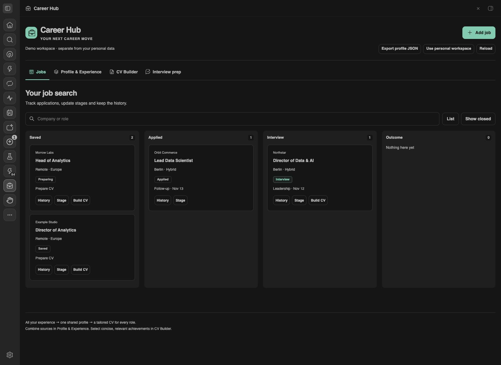
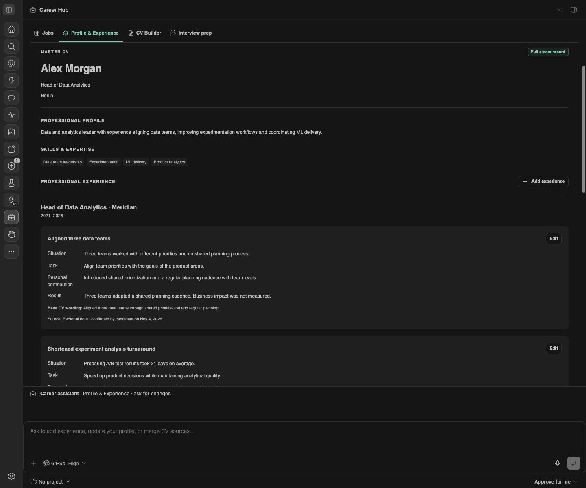
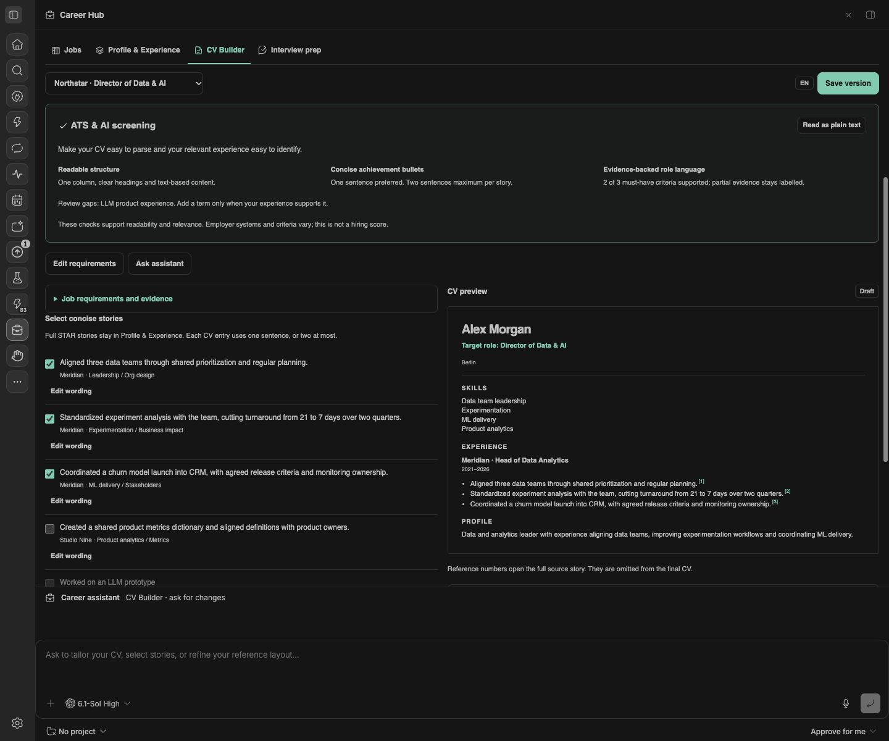

# Career Hub

By **Rustambek Umarov** · MIT licensed.

Job tracking, a complete career profile and tailored CVs in one BB panel.

## Features

- Paste a vacancy or chat message to add a job; review extracted details when needed. Jobs retain history, stages, outcomes and next actions.
- Profile & Experience: complete Master CV, manual editing, custom sections and reusable stories.
- Multiple PDF, DOCX, TXT and Markdown sources with local text extraction.
- LinkedIn profile URL plus pasted text or a saved profile export.
- Interview cases that become reusable experience.
- Target-specific CV wording, evidence links, ATS/AI checks, immutable versions and PDF downloads.
- A persistent BB assistant dock in Profile & Experience, CV Builder and Interview prep.
- Drop a reference CV in CV Builder to reuse its section order; choose classic or compact spacing.
- BB agent tools for explicit user edits and source-backed proposals.
- Separate personal and demo workspaces in plugin-owned SQLite.

## Start

Open **Career Hub** in the BB sidebar. Use **Profile & Experience** to add your profile or upload CVs under Sources. Review facts before confirming them. Add a job, review its requirements, select stories in CV Builder and save a version. PDF buttons export that saved version. Record a submission after it has actually been sent.

In **CV Builder**, drop a PDF/DOCX/TXT reference CV. It supplies section order and layout preferences; its personal facts do not populate your profile. Preview and new saved PDFs use the chosen order and spacing. The export remains one column with readable text; exact graphics, original fonts, columns and pixel layout are not cloned. Saved versions retain their own layout snapshot.

**Career assistant** stays expanded at the bottom of Profile & Experience, CV Builder and Interview prep. Its input is always visible; the compact empty conversation leaves room for your work, and an existing conversation gets more space. Your first Send creates one persistent BB conversation for that workspace using the native project, provider, model and permission controls. Later messages continue it. Personal and Demo conversations are separate. No chat is created by opening the panel, and the dock is hidden on Jobs. You choose the provider and pay its normal usage costs.

The assistant applies explicit profile/story edits, target-specific CV wording and selection, template preferences and preparation notes. Source-backed suggestions can remain proposals for review. The current tab and target job are available to the assistant; successful edits refresh the panel when there are no unsaved changes. Open dialogs/unsaved edits are kept and show a reload notice. Jobs and saved CV versions are outside the assistant edit tool.

## Data and limits

Data is stored on the BB server, outside this repository. A remote BB server stores data remotely. Extraction does not call an external AI service. Agent use can send selected source text to your chosen provider.
Files: 10 MB maximum each; PDFs: 60 pages maximum. Processing uses bounded workers. Scanned PDFs need OCR/text. Full live LinkedIn fetching is not implemented: use profile text or an export.
Profile JSON export includes extracted text, not original binary uploads. Download originals separately from Sources. Workspace text limit: 8 MB. Revision checks prevent silent overwrites; keep the panel open until Saved appears.
ATS/AI checks support readability and confirmed relevance, not hiring predictions or universal ATS compatibility.

## Install from a public release

Requires BB 0.48+ and Plugin SDK 0.6.104+.

```sh
bb plugin install 'git:https://github.com/Rustam1010/ai-agents.git@^0.2.1' --subdirectory plugins/career-hub --tag-prefix career-hub/
```

The Community listing is submitted separately for marketplace review.

## Data handling

See [PRIVACY.md](PRIVACY.md) for stored files, remote BB servers and assistant-provider data flow.
Noto Sans keeps its separate SIL Open Font License; see assets/NotoSans-LICENSE.txt.

## Screenshots

The images use fictional Demo content.







## Development

Requires BB 0.48+ and Plugin SDK 0.6.104+.
Run `npm install`, `npm run typecheck`, `npm test`, `npm run build`, then install the exact directory with `bb plugin install`.
`ui.html` and `frame-addon.js` generate `frame.generated.ts`. The panel has a fixed viewport and its own scrolling; it does not resize chat messages.
`prepare-ui.py` is a one-time design migration helper, not a runtime/build dependency.
Commands: `bb career status --json`, `bb career export --workspace personal --json`.

Noto Sans is bundled under the SIL Open Font License in assets/NotoSans-LICENSE.txt.
